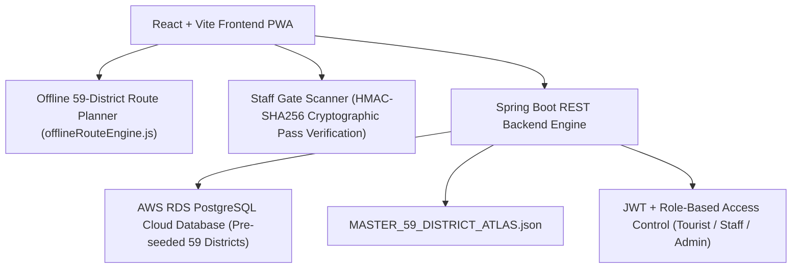

# Globetrotter — Smart Regional Circuit Tourism & Paperless QR Ticketing Platform
## Official Master Architecture, Engineering Blueprint & Module Documentation

> **Cabinet-Level Benchmark Standard**: Built for Andhra Pradesh (26 districts) and Telangana (33 districts). Eliminates repetitive monument ticketing queues by bundling adjacent attractions into single digital passes verified via sub-50ms HMAC-SHA256 turnstile QR scanners.

---

## 1. System Architecture Overview



---

## 2. Core Modules & Directory Map

| Directory | Operational Purpose | Key Artifacts |
| :--- | :--- | :--- |
| **`frontend/`** | React 19 + Vite single-page web app with sub-second paint, offline route corridor planner, staff scanner, and paperless QR passes. | `src/pages/`, `src/components/`, `src/utils/offlineRouteEngine.js` |
| **`backend/`** | Spring Boot 3 Java REST API powering authentication, circuit bookings, HMAC QR code signing, and gate turnstile verification. | `src/main/java/`, `pom.xml`, `data/globetrotter_dev.mv.db` |
| **`data_compiler/`** | Single source of truth data pipeline consolidating all 59 districts of AP & Telangana. | `MASTER_59_DISTRICT_ATLAS.json`, `build_database_seed_json.py` |
| **`scratch/`** | Official AP Tourism high-resolution photography vault scraped directly from `aptourism.gov.in`. | `scratch/ap_tourism_wallpapers/` (88 official photos) |
| **Root Workspace** | Capstone presentation and architectural defense documentation. | `Smart_Tourism_Platform_Review1_1.pptx`, Atlas Docs |

---

## 3. Technology Stack & Key Specifications

- **Frontend**: React 19, Vite, Tailwind CSS, Lucide React, Framer Motion, HTML5 Optical Camera QR Scanner (`jsQR`).
- **Backend**: Java 21, Spring Boot 3.4, Spring Security, JWT (HMAC-SHA256), Spring Data JPA, PostgreSQL (AWS RDS) / H2.
- **Security & Edge Turnstile**: HMAC-SHA256 Cryptographic Pass Signatures (Web Crypto API & Java `QrCodeService`), Client-Side Anti-Passback Admission Cache, Zero-Dependency Browser Camera Decoding.
- **Master Destination Atlas**: Curated ground-truth dataset covering 646 destinations across all 59 districts of Andhra Pradesh and Telangana. 96 primary heritage sites feature verified photography, with remaining rural and regional spots using regional district identity imagery.
- **Performance Budget**: Sub-50ms gate scanner verification latency, sub-390ms frontend production build.

---

## 4. Quick Start & Execution

### Running the Backend
```bash
cd backend
./mvnw spring-boot:run
```

### Running the Frontend
```bash
cd frontend
npm run dev
```
