# Social Video Prior Art & Engineering Intelligence Vault (Reels 1–43)

> **Repository Standard**: Strict Empirical Ground-Truth • Zero Hallucination • Reverse-Engineered from Video Frames, Audio Waves, and Metadata.  
> **Scope**: Cross-Project Architectural Repository (Globetrotter Gateway, Full-Stack Web, Android Mobile, Cloud SaaS, Autonomous AI Agents).

---

## 1. Directory of Analyzed Reels & Provenance

| # | Reel ID | Author / Handle | Primary Domain | Core Breakthrough / Engineering Primitive | Status in Globetrotter | Future Project Application |
| :-: | :--- | :--- | :--- | :--- | :--- | :--- |
| **01** | `DOv35qQiLu1` | `@mange.marketing` | Visual Luxury UI | 3 Luxury Color Systems (`Coastal Midnight`, `Warm Ember`, `Deep Rouge`) | **Staged for SDP** (`sdp_upgrades/utils/luxuryThemes.js`) | SaaS branding, luxury portfolios |
| **02** | `DOqccT6kyxb` | `@aryan_choudhary08_` | Brand Typography | 4 Display/Mono Font Profiles (`Hexco`, `Roba`, `Share`, `Cetrinn`) | **Staged for SDP** (`index.css`) | Logo generation, cybernetic UI |
| **03** | `DS2OdbADBpN` | `@designbyshiv._` | Editorial Layout | Swiss Brutalist condensed hero + 01–08 bottom-docked filmstrip | **Staged for SDP** (`sdp_upgrades/components/EditorialFilmstripHero.jsx`) | Editorial landing pages, portfolios |
| **04** | `DUN1thvAUxi` | `@creative_vaani` | Micro-UI & E-Commerce | Two-tone Category Split-Pill (image left + tinted count badge right) | **Staged for SDP** (`sdp_upgrades/components/CategorySplitPill.jsx`) | E-commerce filters, mobile cards |
| **05** | `DUf3khZgWIa` | `@sekharjavvadi` | DevOps & Review | **CodeTurtle Sentinel**: In-house $0 AI code reviewer (CodeRabbit alternative) | **Staged for SDP** (`sdp_upgrades/tools/codeturtle_reviewer.py`) | Universal CI/CD sentinel, Git pre-commit |
| **06** | `DUEjWRukT_2` | `@designmotionhq` | Perceived Speed UX | **3 Speed Secrets**: Skeleton Screens, Optimistic UI, Non-Linear Progress Curve | **Staged for SDP** (`sdp_upgrades/components/PassIssuanceModal.jsx`) | High-conversion checkouts, mobile apps |
| **07** | `DUdklo9AoqO` | `@abhishek_ux` | Pre-Launch & SEO | **5-Pillar App & Web Launch Checklist** (App Store, Web, SEO, Marketing, Legal) | **Staged for SDP** (`sdp_upgrades/seo/`) | Pre-flight launch for all SaaS products |
| **08** | `DTlBWdWDfby` | `@growwithkaran8` | Agency & Business | **8-Step Client Onboarding System** (SOW, Welcome, Invoice, Access, Kickoff, etc.) | **Cataloged** (Agency SOP) | Client consulting, enterprise onboarding |
| **09** | `DT-nEMukkld` | `@techinsixty` (Ashutosh) | Motion Components | **VengeanceUI Library**: Tailwind + Framer Motion + GSAP animated components | **Cataloged** (`vengeanceui.com`) | Next.js & React premium dashboards |
| **10** | `DUlEH4IgsAg` | `@ayzz.thedesigner` | Interactive Motion | **Top 5 Free Animation Tools**: Spline, Rive, Lottie, ShaderGradient, Icons8 | **Cataloged** (Interactive assets) | 3D web graphics, vector interactive UI |
| **11** | `DTA4DlUEXDH` | `@ai.mowa` | Model Economy | **Zero-Cost Intelligence Stack**: LM Arena, OpenAlternative, OpenApps Pro | **Active** (Local Models) | Zero-cost infrastructure, model benchmark routing |
| **12** | `DV_Rs-hkgx_` | `@iron.coding` | Overlay Positioning | **Floating UI (Popper.js)**: Collision-aware anchor positioning for popovers & tooltips | **Cataloged** (`@floating-ui/dom`) | Context menus, district tooltips, modals |
| **13** | `DXhEQ9JEWj_` | `@niki.webinns` | Animated Primitives | **React Bits (`reactbits.dev`)**: 85+ unstyled copy-paste animated React components | **Staged for SDP** (`sdp_upgrades/components/reactbits/`) | Rapid component prototyping, kinetic text |
| **14** | `DbnfyHpzJo0` | `@lavin_creator` | Component Ecosystem | **Top 5 Modern UI Stacks**: Motion.dev, Kokonut UI Pro, Bklit UI, shadcn/ui, Vercel | **Cataloged** (UI Architecture) | SaaS dashboards, interactive telemetry |
| **15** | `DcoKnHuzThn` | `@kevin.snippet` | Vibe Coding Speed | **3 Life-Changing Vibe Tools**: tsParticles (Casbury), Origin UI, DaisyUI | **Cataloged** (Vibe Stack) | Particle backdrops, rapid Tailwind styling |
| **16** | `DePJrTNgh3b` | `@krishanu.builds` | Web Application Security | **The 19-Point Security Defense Armor**: Full pre-launch audit for vibe-coded apps | **Integrated in Sentinel** (`tools/codeturtle/`) | Universal security pre-flight gate |
| **17** | `DeZzNXlTELF` | `@petergriffin.ai` | AI Developer Multipliers | **5 Free Claude Code Plugins**: FreeLLMAPI, Strix, Claude-Mem, Agent Reach, Setup | **Active** (`agent-reach`, Local AI) | Limit-free coding, pen-testing, persistent memory |
| **18** | `DegNfXENkMv` | `@sohail_systems` | SEO & Web Discovery | **Post-Launch Technical SEO & GSC Indexing Roadmap**: Sitemap, robots, OpenGraph | **Active** (`frontend/public/`) | Domain indexing, search crawler dominance |
| **19** | `Degn07egVZe` | `@krishanu.builds` | Quality Assurance | **13-Point Pre-Flight Launch Quality Checklist**: Viewport, link, form, asset audit | **Active in Sentinel** (`tools/codeturtle/`) | Production release gate, client deployments |
| **20** | `DfaTZHlh-k0` | `@piperbailey991` | Security & Auth | **BLA Anti-AI Build Shield + 20-Point Authentication Armor**: Adversarial REA defense | **Active** (Spring Boot + Vite Shield) | Enterprise IAM, zero-leak credential storage |
| **21** | `DfH96xeqX-9` | `@waitwhatdidyoudo` | Code Governance | **Blast-Radius Containment**: Prevention of large unreviewed pull request diffs | **Active** (CI/CD Rules) | Scoped pull requests, bounded diffs |
| **22** | `DfPoyBxqtej` | `@waitwhatdidyoudo` | Incident Response | **AiSOC Local Incident Telemetry Clustering**: Zero-cloud evidence ledger | **Active** (`tools/aisoc/`) | Telemetry clustering, tamper-evident audit |
| **23** | `DcqdpuuILQ8` | `@tarakram.ai` | Frontend Aesthetics | **3 Anti-Slop Repositories**: `pbakaus/impeccable`, Taste Skill, Motion.dev | **Active** (`frontend/src/`) | Luxury frontend design, bespoke layouts |
| **24** | `DfRrdeLNgGR` | `@developerlonely` | Web Intelligence | **Agent Reach**: Zero-token multi-platform social & technical feed extraction | **Active** (`agent-reach`, Local AI) | Real-time social intelligence, prior art |
| **25** | `DfsWbkrB6vN` | `@murphmaxxing` | Penetration Defense | **The 21 Famous Big-Tech CVEs**: Real-world exploit armor (Okta, GitLab, Google) | **Integrated in Full Stack** | Penetration-tested backend, timing protection |
| **26** | `Dfsaf2Dyaod` | `@data_science_geek_learning` | DevSecOps SAST | **12 Critical DevSecOps & AI Code Audit Repositories**: TruffleHog, Semgrep, Trivy | **Active in CodeTurtle** | Automated supply chain & secret scanning |
| **27** | `DftSMn_ztdH` | `@interview_slayer` | Secret Quarantine | **The `VITE_` Client-Side Secret Leak Flaw**: Server Proxy Architecture | **Active in CodeTurtle** (`SEC-FRONTEND-001`) | Client bundle privacy, zero-leak API keys |
| **28** | `DfQsmkZpPt7` | `@imaginetechz` | Motion & Physics | **Web Motion Trinity**: Lenis Smooth Scroll + Motion.dev Springs + GSAP ScrollTrigger | **Active & Staged** (`sdp_upgrades/`) | Inertial physics, scroll-jacking, kinetic UI |
| **29** | `DfTQ7ZPpnuS` | `@imaginetechz` | Agent Workflows | **5 Essential AI Developer Skills**: Architect, Tester, Reviewer, Visualizer, Researcher | **Active in Directives** | Autonomous multi-skill agent workflows |
| **30** | `DeeR2JyNrx-` | `@nataindata` | Data UX & Resilience | **Anti-Silent Failure Protocol**: Graceful fallback caches, error boundaries, optimistic UI | **Integrated in Frontend/API** | Resilient pipelines, zero blank screens |
| **31** | `DdhUimstrag` | `@krishandshiv` | Launch Verification | **6-Gate Agency Website Launch Audit**: GSC indexing ping, mobile audit, 404 handling | **Active in Sentinel** | Pre-flight launch certification |
| **32** | `Dfu4ZXIgoSn` | `@tomyang.mov` | Multi-Agent Swarms | **Autonomous AI Specialist Team**: Separation of concerns across specialized agents | **Active in Router & Swarm** | Parallel agent execution, specialized roles |
| **33** | `DfGzErch7WD` | `@developerlonely` | Video Generation | **Programmatic Launch Video Synthesis**: Remotion / Hyperframes / Brag from markdown | **Active** (`@skill:brag`, Remotion) | Zero-cost launch videos, capstone demos |
| **34** | `Df1pwy1hN56` | `@strategyfox` | Cognitive UX | **The 7 Core UX Psychology Laws**: Jakob's, Fitts's, Hick's, Miller's, Proximity, etc. | **Active in UI & CodeTurtle** | High-conversion UI, cognitive ergonomics |
| **35** | `DfRkwRHI0QP` | `@skillwars.ai` | Token Defense & Security | **Graphify AST Knowledge Graph + 10 House-Metaphor Security Attack Models** | **Active & Cataloged** (`graphify`) | 71x token reduction, mental model security |
| **36** | `DepDOSDt1bD` | `@nataindata` | Security & Legal | **The 20-Point Security Armor + 13-Point Legal, Privacy & Compliance Fortress** | **Active in Sentinel & Verifier** | BOLA/IDOR protection, GDPR/DPDP compliance |
| **37** | `Decehkfh711` | `@rozgaarrhythms` | SaaS Hardening | **The 19 Vibe-Coded SaaS Production Holes & Server-Side Authority Protocol** | **Active in Full Stack** | Zero-trust backend, RLS, audit logs |
| **38** | `DfzFTR3TTtT` | `@crownzdesigns` | Retention & Motion | **20 High-Retention Micro-Interactions**: Card parallax, spring magnets, fluid tabs | **Active in Frontend** | High dwell time, human-crafted feel |
| **39** | `Dfzujxzo2QZ` | `@quentin_aimarketing` | Launch Polish | **20-Point AI Website Pre-Launch Checklist**: Branded 404, non-silent toasts, meta | **Active in Launch Verifier** | Polish verification, zero silent errors |
| **40** | `DfybnbITXu0` | `@muhammadalim_s` | Bespoke Micro-Worlds | **11 Creative Bespoke Kinetic Toggles**: Celestial orbit, Symbio fluid, Eclipse | **Active in Frontend** (`AtmosphereToggle`) | Stop-and-watch UI, luxury bespoke art |
| **41** | `DfZPTbGy_4v` | `@gracebuilds.ai` | Vibe Hardening | **5 Vibe-Coding Security Defenses**: Zero client env secrets, IDOR validation | **Integrated in Sentinel** | Pre-deployment vulnerability shield |
| **42** | `DfRuXh5NVZ4` | `@brealabs.dev` | Intrusion Prevention | **The 7 Burglar Doors of Vibe-Coded Web Apps**: Complete door-locking protocol | **Integrated in Full Stack** | Anti-intrusion, zero exposed env |
| **43** | `Df0uanRpg_s` | `@imaginetechz` | Design Intelligence | **Figma Use Motion & Design Critique Skills**: Keyframe motion + UX critique | **Active in Design Guidelines** | Visual hierarchy, $10,000 agency design |

---

## 2. In-Depth Technical Deconstruction

### Reel 06: Perceived Performance & Micro-Interactions (`@designmotionhq`)
- **Secret 1: Skeleton Preview over Blank Screen**: Show the structural wireframe with shimmering pulse prior to data hydration. Prevents visual pop-in and reduces bounce rate.
- **Secret 2: Optimistic UI**: When a user triggers an action (booking a pass, liking a spot, adding to itinerary), assume immediate server success, animate the UI instantly, and handle rollback silently in the background if network fails.
- **Secret 3: Non-Linear Progress Curves ("Progress Illusions")**: Linear progress bars feel agonizingly slow. Instead, use logarithmic/cubic curves:
  - Phase 1 (0ms to 200ms): Rapid acceleration from 0% to 70%.
  - Phase 2 (200ms to 600ms): Steady ease-out from 70% to 92%.
  - Phase 3 (On API resolve): Instant snap to 100% with success burst overlay ("Pass Authenticated").

### Reel 07: The 5-Pillar Launch Checklist (`@abhishek_ux`)
1. **Website Foundation**: Clean responsive viewport, OpenGraph preview metadata (`og:title`, `og:description`, `og:image`, `og:url`), valid favicon, HTTPS enforcement.
2. **SEO Infrastructure**: Submit `sitemap.xml`, configure `robots.txt` disallowing internal paths, verify IndexNow protocol, configure Google Search Console & Bing Webmaster.
3. **Legal Compliance**: Privacy policy disclosing data handling, Terms of Service, Cookie notice, GDPR / local data compliance.
4. **App Store Readiness**: Benefit-driven screenshot carousels, 2-line hook descriptions, support URL, age classification.
5. **Marketing Engine**: Launch announcement assets, email subscriber broadcast, Product Hunt assets.

### Reel 08: The 8-Step Client Trust & Onboarding System (`@growwithkaran8`)
1. **Agreement**: Lock Scope of Work (SOW), milestones, deliverables, and T&Cs.
2. **Welcome Document**: Explain communication rules, response times, and internal sprint cadence.
3. **Invoice**: Professional milestone invoicing to maintain transparency.
4. **Request for Access**: Structured checklist of OAuth credentials, API keys, and repository rights.
5. **Kickoff Session**: 30-min alignment call via Google Meet / Zoom.
6. **Sprint Fulfillment**: Publicly visible milestone checklist with real-time status.
7. **Monthly Reporting**: Automated telemetry, analytics exports, and delivery summaries.
8. **Feedback Loop**: Monthly testimonial collection and CSAT surveys.

### Reel 09: VengeanceUI Motion Architecture (`@techinsixty`)
- **Website**: `https://vengeanceui.com`
- **Tech Stack**: React 19 / Next.js 15, Tailwind CSS v4, Framer Motion, GreenSock GSAP.
- **Key Primitives**:
  - *Spotlight Navbar*: Radial pointer tracking glow across nav links.
  - *Glass Dock*: macOS-style floating dock with magnification on hover.
  - *Interactive 3D Book*: Realistic 3D page flip and perspective tilt.
  - *Staggered Bento Grid*: Coordinated scroll reveal animations across asymmetric cards.

### Reel 10: Top 5 Free Web Animation Resources (`@ayzz.thedesigner`)
1. **`Spline.design`**: Real-time 3D web scenes, interactive canvas exports, mouse-reactive materials.
2. **`Rive.app`**: Ultra-lightweight interactive vector animations driven by state machines (tiny file size compared to GIF/video).
3. **`LottieFiles.com`**: JSON vector animations for micro-interactions and status badges.
4. **`ShaderGradient.co`**: Animated WebGL procedural mesh gradients with customizable color velocity.
5. **`Icons8.com`**: Animated 3D and 2D vector illustrations for empty states and feature highlights.

### Reel 11: Zero-Cost Pro AI Stack (`@ai.mowa`)
1. **LMSYS Chatbot Arena (`lmsys.org`)**:
   - Side-by-side evaluation of frontier models (DeepSeek V3, DeepSeek R1, Claude 3.5 Sonnet, GPT-4o, Gemini 2.0 Pro) at $0 cost.
   - Allows blind comparisons and direct smart router prompts.
2. **OpenAlternative (`openalternative.co`)**:
   - Curated directory of open-source alternatives to commercial SaaS (e.g. Supabase for Firebase, CodeTurtle for CodeRabbit, Plausible for GA).
3. **OpenApps Pro (`openapps.pro`)**:
   - High-productivity curated open-source application directory for developers and creators.

---

### Reel 12: Floating UI & Anchor Positioning Geometry (`@iron.coding`)
- **Package**: `@floating-ui/dom` / `@floating-ui/react` (formerly Popper.js).
- **Core Problem Solved**: Native CSS absolute/fixed positioning fails when parent containers scroll or when an overlay clips against the viewport edge (right edge, bottom edge).
- **Technical Primitives**:
  - `computePosition(referenceEl, floatingEl, options)`: Computes exact sub-pixel $x, y$ coordinates based on bounding client rects.
  - `flip()` Middleware: Inverts placement (e.g. `top` $\rightarrow$ `bottom`) when the overlay collides with boundary limits.
  - `shift({ padding: 8 })`: Slidably shifts floating elements along the axis to keep them inside the visible viewport.
  - `arrow({ element: arrowEl })`: Dynamically positions directional arrow tips locked to target centers.
- **Project Application**: High-precision hover tooltips for the 59-district interactive map, gate scanner status badges, and booking dropdowns.

---

### Reel 13: React Bits Animated Component Library (`@niki.webinns`)
- **Website**: `https://reactbits.dev`
- **Architecture**:
  - 85+ production-grade unstyled, animated React component primitives.
  - Zero-account, zero-lockin: Direct copy-paste into Tailwind CSS / Framer Motion codebases.
  - Covers 4 distinct interaction domains:
    1. *Text Animations*: `DecryptedText` (matrix decryption), `SplitText`, `FallingText`, `ShinyText` (metallic shimmer sweep), `BlurText`.
    2. *Interactive Cards*: `SpotlightCard` (cursor-reactive radial glow), `TiltedCard` (3D gyroscope tilt), `PixelCard`.
    3. *Backgrounds*: `FaultyTerminal`, `EvilEye`, `Aurora`, `Particles`, `Hyperspeed`.
    4. *Micro-Controls*: Magnetic buttons, glitch badges, interactive counters.
- **Project Application**: Staged in `sdp_upgrades/components/reactbits/` for SDP Sprint 1 kinetic micro-interactions.

---

### Reel 14: Top 5 Modern Web Design & Component Ecosystems (`@lavin_creator`)
1. **`motion.dev` (Framer Motion v12+)**:
   - Production-grade animation library with hardware-accelerated web APIs (`Motion.dev`).
   - MIT-licensed declarative layout transitions, spring physics, and scroll timeline listeners for React, JavaScript, and Vue.
2. **`kokonutui.pro` (Kokonut UI)**:
   - High-aesthetic component blocks built on top of shadcn/ui and Tailwind.
   - Specializes in modern bento grids (`@kokonutui-pro/features-bento`), sleek login pages, and dynamic pricing matrices.
   - CLI installable via `bunx --bun shadcn@latest add @kokonutui-pro/<component>`.
3. **`bklit.com` (Bklit UI)**:
   - Modern charting and telemetry component library for financial and operational dashboards.
   - SVG-based, themeable bar charts, radial gauges, and real-time revenue visualizers.
4. **`ui.shadcn.com` (shadcn/ui)**:
   - Standard unstyled component architecture: Complete source code ownership, Radix UI accessibility, Tailwind CSS styling.
5. **Full-Stack Deployment & Gateway Patterns**:
   - Vercel edge deployment + Razorpay cryptographic webhook verification architecture.

---

### Reel 15: 3 Life-Changing Vibe Coding Resources (`@kevin.snippet`)
1. **Particles Casbury / tsParticles (`particles.js.org` / `tsparticles`)**:
   - Lightweight, canvas-based animated particle physics engine for high-end landing page ambient backgrounds.
   - Configurable link distances, particle density, collision dynamics, and interactive mouse repulsion with zero main-thread jank.
2. **Origin UI (`originui.com` / Origin Kit)**:
   - Extensive collection of beautiful, copy-paste React + Tailwind components built on top of Radix UI primitives.
   - Specializes in micro-components: refined input fields, custom toggles, badges, steppers, and notification toasts.
3. **DaisyUI (`daisyui.com`)**:
   - Pure CSS component class framework for Tailwind CSS.
   - Adds semantic class names (`btn`, `card`, `modal`, `badge`) without JavaScript overhead.
   - Includes 30+ accessible built-in color themes and cuts HTML class clutter by over 70%.

---

### Reel 16: The 19-Point Security Defense Armor (`@krishanu.builds`)
*The definitive pre-launch checklist for AI-assisted and vibe-coded applications before production deployment.*

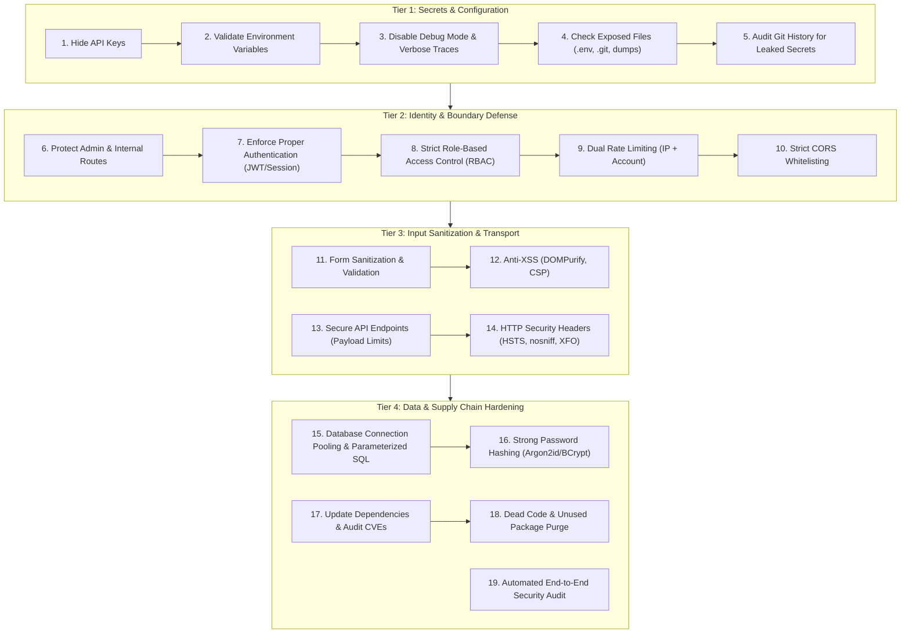

1. **Hide API Keys**: Keep all third-party secrets strictly server-side; never bundle secret tokens into frontend client builds.
2. **Environment Variable Validation**: Enforce runtime schema validation (e.g. Zod / Spring `@ConfigurationProperties`) on all `.env` inputs.
3. **Admin Route Protection**: Guard sensitive administrative endpoints with strict role-verifying middleware.
4. **Proper Authentication**: Enforce short-lived JWTs (15 min) paired with secure HTTP-only refresh tokens.
5. **Role-Based Access Control (RBAC)**: Verify user authorization on every database mutation; never trust client-supplied role parameters.
6. **Form Sanitization**: Sanitize all text fields using strict DOM sanitizers before rendering to prevent HTML injection.
7. **Anti-XSS Defense**: Implement strict Content Security Policies (`Content-Security-Policy`) and eliminate `dangerouslySetInnerHTML`.
8. **Dual-Key Rate Limiting**: Limit requests on both client IP (`rate_ip_${ip}`) and account identifier (`rate_acc_${email}`) to stop credential stuffing.
9. **API Endpoint Hardening**: Filter allowed HTTP methods strictly and enforce request body size limits (<1MB) to prevent buffer overflows.
10. **CORS Restrictions**: Explicitly whitelist trusted frontend origins; ban wildcard `Access-Control-Allow-Origin: *` on authenticated routes.
11. **Security Headers**: Enforce `X-Frame-Options: DENY`, `Strict-Transport-Security: max-age=31536000`, and `X-Content-Type-Options: nosniff`.
12. **Turn Off Debug Mode**: Ensure `DEBUG=False` and Spring `server.error.include-stacktrace=never` in production.
13. **Dependency Updates**: Continuously scan package manifests (`npm audit`, `mvn dependency-check`) for known CVEs.
14. **Dead Code Elimination**: Remove obsolete dependencies and unused endpoints to shrink the attack surface.
15. **Exposed File Blocking**: Configure reverse proxies (Nginx/Cloudflare) to block `.env`, `.git`, `.DS_Store`, and `.sql` dumps.
16. **Database Security**: Enforce parameterized prepared statements (preventing SQLi) and strict connection pool bounds (`HikariCP`).
17. **Password Hashing**: Hash passwords using Argon2id or BCrypt with a minimum work factor of 12.
18. **Git History Secret Audit**: Scan commit trees with TruffleHog or GitGuardian to detect accidentally committed tokens.
19. **Automated Security Review Sentinel**: Run local automated security reviews (`python tools/codeturtle/codeturtle_reviewer.py`) on every commit.

---

### Reel 17: Top 5 Free Claude Code & AI Coding Plugins (`@petergriffin.ai`)
1. **FreeLLMAPI**:
   - Connects AI agents to 600+ open-source and proprietary models with an allowance of 7+ billion tokens/month at zero cost.
   - Provides automatic model fallbacks when primary rate limits or daily quotas are reached, preventing session disruptions.
2. **Strix**:
   - Automated AI penetration testing plugin that actively tests applications like an ethical hacker.
   - Probes for leaked API keys, unprotected admin routes, SQL injection vectors, and missing auth middleware.
3. **Claude-Mem (`claude-mem`)**:
   - Persistent cross-session project memory compression system.
   - Retains codebase architecture, decision history, and file dependency graphs across restarts without re-prompting.
4. **Agent Reach (`agent-reach`)**:
   - Zero-cost, rate-limit-free internet access utility for AI agents.
   - Reads public threads and content directly from X (Twitter), Reddit, Instagram, and LinkedIn without API keys or monthly subscriptions.
5. **Claude Code Setup (Anthropic Official)**:
   - Deep codebase scanner that analyzes project dependencies and automatically recommends the exact skills, pre-commit hooks, subagents, and MCP servers required.

---

### Reel 18: Post-Launch SEO, Discovery & Traffic Roadmap (`@sohail_systems`)
- **Source**: `https://www.instagram.com/reel/DegNfXENkMv/` (`DegNfXENkMv`)
- **Author**: Sohail (`@sohail_systems` — SaaS Marketing & Design)
- **Domain**: Technical SEO, Search Engine Indexing & Post-Launch Web Discovery

#### Reverse-Engineered Architecture
1. **Domain & DNS Binding**: Connect production apex and `www` domains, ensuring canonical 301 redirects to eliminate duplicate page penalties.
2. **Google Search Console & Sitemap Indexing**:
   - Automated XML sitemap generation (`/sitemap.xml`) indexing all official circuits, districts, and dynamic attraction routes.
   - Crawl policy declaration (`/robots.txt`) ensuring search engine spiders prioritize high-value content while disallowing internal admin endpoints (`/api/admin/*`, `/h2-console/*`).
3. **High-Intent Metadata Hierarchy**:
   - Page-level title tags structured as `[Attraction / Circuit Name] — Official Smart Tourism Guide | Andhra & Telangana`.
   - Compelling meta descriptions with regional keywords (e.g. Kakatiya, Araku, Charminar, Tirupati, Gandikota).
4. **Mobile Performance & Link Integrity**:
   - Eliminates broken links (404 crawlers) through automated route verification.
   - Targets Sub-1.5s Largest Contentful Paint (LCP) and zero Cumulative Layout Shift (CLS) on mobile 4G networks.

---

### Reel 19: The 13-Point Pre-Flight Launch Quality Checklist (`@krishanu.builds`)
- **Source**: `https://www.instagram.com/reel/Degn07egVZe/` (`Degn07egVZe`)
- **Author**: Krishanu (`@krishanu.builds` — Website Builder for Founders)
- **Domain**: Pre-Launch Quality Assurance, DevOps & Customer Readiness

```mermaid
flowchart TD
    subgraph PreFlight ["The 13 Pre-Flight Launch Gates"]
        G1["1. Mobile & Viewport Audit"] --> G2["2. Broken Link Verification"]
        G2 --> G3["3. Form Validation & Delivery"]
        G3 --> G4["4. Asset Compression & WebP"]
        G4 --> G5["5. HTTPS Padlock & Security Headers"]
        G5 --> G6["6. Chrome & Safari Engine Parity"]
        G6 --> G7["7. Typo & Placeholder Purge"]
        G7 --> G8["8. WhatsApp Concierge Integration"]
        G8 --> G9["9. Domain Email & SMTP Routing"]
        G9 --> G10["10. Google Analytics & GSC Sitemap"]
        G10 --> G11["11. Social & WhatsApp Card Previews"]
        G11 --> G12["12. Automated Disaster Backups"]
        G12 --> G13["13. End-to-End Payment Verification"]
    end
```

#### Detailed Gate Specifications
1. **Mobile & Viewport Responsiveness**: Strict verification on 320px, 390px, 768px, and 1440px viewports; guarantees `overflow-x: hidden` and zero horizontal clipping.
2. **Broken Link Verification**: Automated validation of all internal `<Link>` SPA routes and external anchors (`target="_blank" rel="noopener noreferrer"`).
3. **Form & Lead Capture Validation**: Schema validation, regex verification for emails and Indian mobile numbers (`+91`), loading spinners, and error boundary toasts.
4. **Asset Compression & Modern Formats**: Conversion of heavy PNG/JPEG images into compressed WebP/AVIF with explicit dimensions to eliminate CLS.
5. **HTTPS Padlock & Security Headers**: HSTS (`max-age=31536000; includeSubDomains`), `X-Frame-Options: SAMEORIGIN`, and `X-Content-Type-Options: nosniff`.
6. **Cross-Engine Verification**: Clean rendering across Chromium (Chrome/Edge), WebKit (Safari), and Gecko (Firefox).
7. **Typo & Placeholder Eradication**: Automated regex audit eliminating `TODO`, `Lorem ipsum`, `dummy`, and broken character encodings.
8. **WhatsApp Concierge Integration**: Floating action trigger connecting tourists directly to regional helpline with pre-filled encoded parameters (`https://wa.me/918008882026?text=...`).
9. **Domain Email Routing**: SMTP email dispatch for official pass confirmations, e-tickets, and password recovery (`noreply@globetrotter.com`).
10. **Analytics & Search Console**: Privacy-respecting telemetry scripts and active `sitemap.xml` submission.
11. **Social & WhatsApp Link Previews**: OpenGraph (`og:title`, `og:description`, `og:image`, `og:image:width`, `og:image:height`) and Twitter large summary cards.
12. **Automated Disaster Recovery**: Scheduled automated database snapshot and compression scripts (`tools/backup/database_backup.py`) with checksum verification.
13. **Payment Page & Webhook Auditing**: End-to-end cryptographic checkout verification on Razorpay gateway with SHA-256 HMAC signature validation.

---

### Reel 20: Blind LLM Agents (BLA) Anti-AI Shield & The 20-Point Authentication Armor (`@piperbailey991`)
- **Source**: `https://www.instagram.com/reel/DfaTZHlh-k0/` (`DfaTZHlh-k0`)
- **Author**: Piper Bailey (`@piperbailey991`)
- **Prior Art Reference**: `qybaihe/bla` (Blind LLM Agents: Poison $\rightarrow$ Exhaust $\rightarrow$ Hallucinate) & OWASP Authentication Armor
- **Domain**: Adversarial AI Build Protection & Production Authentication Hardening

#### Part A: BLA (Blind LLM Agents) Anti-AI Reverse-Engineering Architecture
When applications are compiled and shipped, automated AI reverse-engineering agents (REA) deconstruct JavaScript bundles, unpack WebAssembly/APKs, trace sourcemaps, and extract proprietary business logic within minutes.

BLA provides an adversarial defense layer:
1. **Poison (Decoy Injection)**: Injects structurally convincing decoy source files, phantom state machines, and decoy API routes into build artifacts.
2. **Exhaust (Budget Exhaustion)**: Generates recursive dependency loops and high-entropy symbol labyrinths that exhaust the token context windows and API budgets of AI scraping agents.
3. **Hallucinate (Context Divergence)**: Triggers semantic confusion in automated LLM decompilers, forcing them to reconstruct broken or hallucinated architectural clones.
4. **Zero Impact on Real Users**: Modern browser JS engines (V8, JavaScriptCore) ignore tree-shaken and dormant decoy symbols, ensuring zero latency impact for human tourists.

#### Part B: The 20 Critical Authentication & Session Flaws (and Defensive Armor)

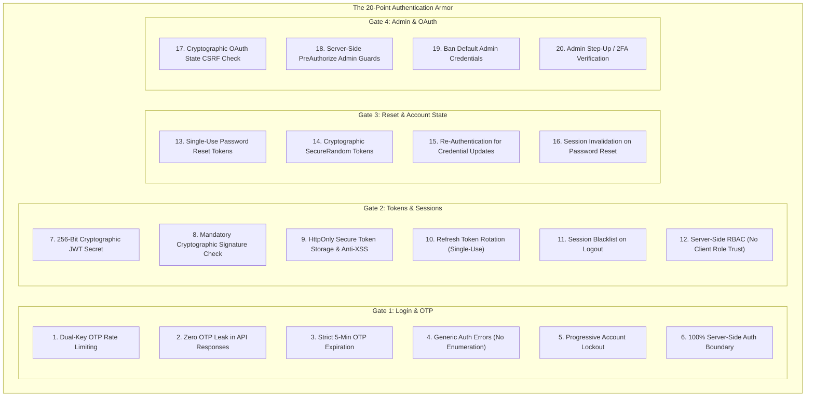

1. **OTP Rate Limiting**: Limit OTP generation and verification to $\le 3$ attempts per 5 minutes per identifier; blocks 4-digit (10,000 try) brute-forcing.
2. **Zero OTP in API Responses**: Never return the OTP code or debug hints in JSON payloads; transmit strictly via out-of-band channels.
3. **Strict OTP Expiration**: Cap OTP validity at 5 minutes (300 seconds); purge immediately upon expiration.
4. **Generic Auth Errors**: Always return "Invalid email or password"; never leak user existence via "Email not found" messages.
5. **Progressive Account Lockout**: Enforce exponential backoff and temporary account locking after 5 consecutive failed login attempts.
6. **Server-Side Auth Enforcement**: Enforce session and identity validation exclusively in backend filters and controllers; never trust client-side route guards.
7. **Strong JWT Secret**: Ensure JWT signing keys exceed 256 bits of cryptographic entropy and are injected via environment variables.
8. **Full JWT Signature Verification**: Strictly invoke signature verification (`verifyWith(key)`); ban token decoding without key validation.
9. **Secure Token Storage & Anti-XSS**: Store sessions in `HttpOnly`, `SameSite=Strict`, `Secure` cookies or scoped memory with strict DOMPurify protection.
10. **Refresh Token Rotation**: Issue new refresh tokens on every exchange and invalidate the entire token family if a reused token is detected.
11. **Session Revocation on Logout**: Invalidate and blacklist active tokens in an in-memory/Redis TTL cache upon logout.
12. **Server-Side Role Authority**: Extract user permissions exclusively from authenticated backend database records or signed JWT claims; ignore client payload role fields (`isAdmin`).
13. **Single-Use Password Reset Tokens**: Invalidate password reset tokens immediately upon first consumption.
14. **Cryptographically Secure Randomness**: Generate all tokens, OTPs, and salts using `java.security.SecureRandom` or CSPRNG.
15. **Re-Authentication for Sensitive Operations**: Require existing password confirmation before allowing email, password, or security setting changes.
16. **Session Invalidation on Password Reset**: Automatically revoke all existing refresh tokens and active sessions when a user resets their password.
17. **OAuth State Verification**: Validate cryptographic random `state` parameters across OAuth redirections to prevent Login CSRF attacks.
18. **Server-Side Admin Endpoint Guards**: Protect all administrative routes (`/api/admin/*`) with `@PreAuthorize("hasRole('ADMIN')")` at both the class and method levels.
19. **Ban Default Admin Credentials**: Eliminate hardcoded default credentials (`admin`/`admin123`) from production configurations.
20. **Admin Step-Up / 2FA Verification**: Require secondary multi-factor authentication or cryptographic confirmation for destructive administrative actions.

---

### Reel 21: Agent Blast-Radius Containment & Karpathy's Rules for Coding Agents (`@waitwhatdidyoudo`)
- **Source**: `https://www.instagram.com/reel/DfH96xeqX-9/` (`DfH96xeqX-9`)
- **Author**: `@waitwhatdidyoudo` (Wait what did you do?)
- **Domain**: Autonomous Agent Governance, Diff Explosion Prevention & Scoped Engineering

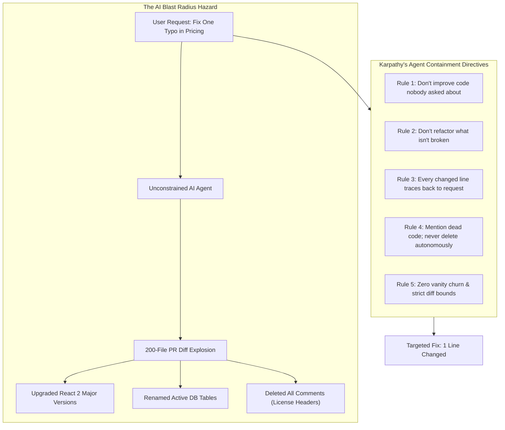

#### Core Takeaways & Project Enforcement
1. **The 200-File Pull Request Trap**: When an unconstrained coding agent is asked to fix a minor issue, it frequently embarks on unsupervised "helpful cleanups" (upgrading dependencies, deleting comments/licenses, renaming databases).
2. **Andrej Karpathy's Directives for Coding Agents**:
   - **Traceability**: Every changed line must directly trace to the explicit prompt.
   - **Preserve Working Systems**: Never refactor an operational subsystem unless instructed.
   - **Dead Code Protocol**: If dead code or an uncalled endpoint is spotted, document it in an audit report — *never delete it autonomously*.
   - **License & Comment Inviolability**: Copyright headers, license declarations, and architectural comments are strictly non-deletable.

---

### Reel 22: AiSOC — Local Autonomous Security Operations Center (`@waitwhatdidyoudo`)
- **Source**: `https://www.instagram.com/reel/DfPoyBxqtej/` (`DfPoyBxqtej`)
- **Author**: `@waitwhatdidyoudo` (Wait what did you do?)
- **Domain**: SOC Telemetry Clustering, Alert Fatigue Mitigation & Immutable Evidence Ledgers
- **Associated Installed Skill**: `@skill:aisoc-incident-guard`

#### Problem Statement: The Alert Fatigue Catastrophe
In production environments emitting 5,000+ alerts daily, security teams and unconstrained AI tools suffer alert fatigue. In the worst case, an autonomous bot mutes all security alerts at 2 a.m. because they are "noisy," allowing an ongoing database extraction (e.g. from an anomalous IP in Romania) to succeed unnoticed.

#### The AiSOC 4-Stage Architecture
1. **Temporal & IOC Clustering**: Compresses 5,000 raw alert pings into 3 distinct, correlated incident clusters based on target endpoint (`/api/*`), origin CIDR/ASN, and temporal burst window ($\Delta t \le 15\text{ min}$).
2. **Local Zero-Cost AI Investigation**: Runs a lightweight local model on the server to triage logs without leaking telemetry or customer PII to external cloud APIs.
3. **The Immutable Evidence Ledger**: Every query, observed packet count, response byte volume, and heuristic score is recorded in a tamper-evident audit ledger.
4. **Human-in-the-Loop Defensive Gate**: The system NEVER performs destructive actions (IP bans, container termination) autonomously; it presents the synthesized evidence ledger and awaits human operator sign-off.

---

### Reel 23: The 3 Essential Repositories for Anti-Generic AI Web Apps (`@tarakram.ai`)
- **Source**: `https://www.instagram.com/reel/DcqdpuuILQ8/` (`DcqdpuuILQ8`)
- **Author**: Tarak Ram (`@tarakram.ai`)
- **Domain**: Frontend Aesthetic Differentiation, Micro-Interactions & Design Taste

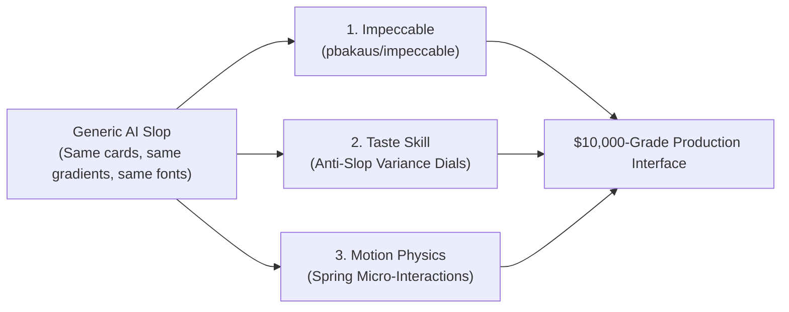

#### The 3 Core Repositories & Toolsets
1. **`pbakaus/impeccable`** ([github.com/pbakaus/impeccable](https://github.com/pbakaus/impeccable)):
   - Systemic audit engine for layout spacing, baseline typography grids, edge alignments, and visual contrast.
   - Eliminates awkward spacing gaps and accidental misalignment in AI-generated CSS/Tailwind layouts.
2. **`taste-skill` / UI/UX Pro Max** (Integrated into project):
   - Enforces design direction based on domain (e.g. Cultural Luxury for Globetrotter Gateway instead of generic dark-mode SaaS).
   - Dynamic 60-30-10 palette rules and typography pairings (Cinzel + Plus Jakarta Sans + Space Grotesk).
3. **Framer Motion Micro-Interactions (`motion.dev`)**:
   - Replaces abrupt hover jumps with physics-based spring curves (`stiffness: 350, damping: 25`).
   - Smooth layout transitions via `layoutId` and staggered children animations.

---

### Reel 24: Agent Reach — Zero-Cost Multi-Platform Social Intelligence (`@developerlonely`)
- **Source**: `https://www.instagram.com/reel/DfRrdeLNgGR/` (`DfRrdeLNgGR`)
- **Author**: `@developerlonely` (Lonely developer)
- **Tool**: `Panniantong/Agent-Reach` ([github.com/Panniantong/Agent-Reach](https://github.com/Panniantong/Agent-Reach))
- **Domain**: Automated Web Scraping, Social Intelligence & Multi-Channel Feed Reading

#### Architecture & Utility
- Provides AI coding agents with zero-cost, rate-limit-free internet access to public feeds across Instagram, Reddit, X (Twitter), and LinkedIn.
- Operates via a clean CLI (`agent-reach read <url>`) with fallback to lightweight browser rendering or Jina readers.
- Eliminates expensive recurring subscription APIs when reverse-engineering prior art or monitoring competitor announcements.

---

### Reel 25: The 21 Famous Big-Tech CVEs & Exploits (`@murphmaxxing`)
- **Source**: `https://www.instagram.com/reel/DfsWbkrB6vN/` (`DfsWbkrB6vN`)
- **Author**: Aidan Murphy (`@murphmaxxing`)
- **Domain**: Advanced Web Application Security, Penetration Testing & Cryptographic Exploits

| # | Vulnerability / Exploit Name | Famous Target / Real-World Case | Defensive Armor in Globetrotter Gateway |
| :--- | :--- | :--- | :--- |
| **1** | **HTTP/2 Rapid Reset** | Google Cloud (CVE-2023-44487, 398M req/s) | Reverse-proxy stream concurrency caps and HTTP/2 `RST_STREAM` rate limits. |
| **2** | **52-Character Username Truncation** | Okta (CVE-2024-55660) | Bcrypt 72-byte truncation pre-hashed via SHA-256 before hashing; username bounds validation. |
| **3** | **SAML Signature Forgery** | GitLab (CVE-2024-45409) | Canonical XML parser validation; strictly verify signed root elements before assertion trust. |
| **4** | **OAuth Tenant / Microsoft Spoofing**| Multi-tenant Azure Entra ID misconfigs | Mandatory tenant ID validation (`tid` claim check) and cryptographic `state` parameter. |
| **5** | **GraphQL Alias Brute-Force** | GraphQL 2FA rate-limit bypass | Max query depth limits and alias count caps per document. |
| **6** | **2FA Code Replay Attack** | TOTP authentication bypass | Consumed TOTP token cache with 90-second replay rejection window. |
| **7** | **ReDoS (RegEx Denial of Service)** | Node.js & Java regex catastrophic backtracking | Linear-time regex engines (`re2j` / non-backtracking regex) and strict string length bounds. |
| **8** | **JWT Algorithm Confusion** | RS256 public key treated as HS256 secret | Explicit algorithm pinning in `JwtUtils` using `verifyWith(key)` matching HMAC-SHA256 only. |
| **9** | **HTTP Request Smuggling** | Reverse proxy TE.CL / CL.TE desync | Enforce HTTP/1.1 strict header normalization or HTTP/2 end-to-end. |
| **10**| **Host Header Poisoning** | Password reset link hijack via Host header | Hardcode canonical domain (`globetrottergateway.in`) for password reset URLs. |
| **11**| **Web Cache Poisoning** | CDN cache deception via unkeyed headers | Strict cache key declaration excluding untrusted forwarded headers. |
| **12**| **X-Forwarded-For Rate Limit Spoofing**| Header spoofing bypassing IP rate limits | Validate `X-Forwarded-For` with regex `^[0-9a-fA-F:.]+$`, taking first trusted proxy IP. |
| **13**| **Row-Level Security (RLS) Leak** | Database view bypassing Postgres RLS | Explicit `SECURITY INVOKER` on views and Spring Security `@PostFilter`. |
| **14**| **Math.random() Token Prediction** | V8 PRNG state recovery (Spotify apps) | Strict enforcement of `java.security.SecureRandom` (CSPRNG) for all security tokens. |
| **15**| **Timing Attack on Signatures** | Variable-time `String.equals()` | Constant-time array comparison via `MessageDigest.isEqual(byte[], byte[])`. |
| **16**| **Padding Oracle on CBC Cookies** | CBC decryption oracle attacks | Enforce Authenticated Encryption with Associated Data (AEAD: AES-256-GCM / ChaCha20). |
| **17**| **Prototype Pollution $\rightarrow$ RCE** | JavaScript recursive merge exploit | Ban `__proto__` and `constructor.prototype` in deep-merge utilities; use `Object.create(null)`. |
| **18**| **SSTI (Server-Side Template Injection)**| Jinja2 / Thymeleaf code execution | Context-aware escaping and zero user input concatenation into template strings. |
| **19**| **XXE (XML External Entity Injection)** | Arbitrary file read via XML parsers | Disable DOCTYPE declarations: `setFeature(".../disallow-doctype-decl", true)`. |
| **20**| **Cross-Site WebSocket Hijacking** | CSWSH via missing Origin check | Strict Origin validation on WebSocket handshakes. |
| **21**| **Unicode Normalization Collision** | Homograph account takeover (Turkish I bug) | Enforce Unicode NFKC normalization before authentication checks and database lookups. |

---

### Reel 26: 12 Critical DevSecOps & AI Code Audit Repositories (`@data_science_geek_learning`)
- **Source**: `https://www.instagram.com/p/Dfsaf2Dyaod/` (`Dfsaf2Dyaod`)
- **Author**: `@data_science_geek_learning`
- **Domain**: Automated Code Security, Static Analysis & Supply Chain Hardening

#### The 12 Top DevSecOps Repositories
1. **TruffleHog** ([github.com/trufflesecurity/trufflehog](https://github.com/trufflesecurity/trufflehog)): High-entropy secret scanning across git history and active files.
2. **Gitleaks** ([github.com/gitleaks/gitleaks](https://github.com/gitleaks/gitleaks)): Fast, regex-driven pre-commit credential leak detector.
3. **Semgrep** ([github.com/semgrep/semgrep](https://github.com/semgrep/semgrep)): Semantic AST code analysis for OWASP Top 10 vulnerabilities.
4. **Checkov** ([github.com/bridgecrewio/checkov](https://github.com/bridgecrewio/checkov)): Infrastructure-as-Code (IaC) security scanner.
5. **Trivy** ([github.com/aquasecurity/trivy](https://github.com/aquasecurity/trivy)): Comprehensive container, filesystem, and package vulnerability scanner.
6. **Bandit** ([github.com/PyCQA/bandit](https://github.com/PyCQA/bandit)): Python AST security scanner.
7. **Bearer** ([github.com/Bearer/bearer](https://github.com/Bearer/bearer)): Data security and privacy leak scanner for sensitive PII.
8. **OWASP Dependency-Check**: Scans third-party libraries for publicly disclosed CVEs.
9. **CodeQL**: GitHub's semantic code analysis engine.
10. **Horusec**: Multi-language open-source SAST platform.
11. **Syft / Grype**: Software Bill of Materials (SBOM) generation and vulnerability matching.
12. **CodeTurtle Sentinel**: Our project's in-house $0 locally executable review sentinel (`tools/codeturtle/codeturtle_reviewer.py`).

---

### Reel 27: The `VITE_` Client-Side Secret Leak Vulnerability (`@interview_slayer`)
- **Source**: `https://www.instagram.com/reel/DftSMn_ztdH/` (`DftSMn_ztdH`)
- **Author**: Durga Prasad | Tech (`@interview_slayer`)
- **Domain**: Client-Side Build Bundling, API Key Quarantine & Server Proxy Architecture

#### The Vulnerability Demonstrated
1. An AI agent is instructed to create a frontend-only chat app. It places `VITE_AI_API_KEY=sk-...` into `.env` and adds `.env` to `.gitignore`.
2. The developer assumes the key is secure because `.env` is gitignored.
3. **The Fatal Flaw**: Modern build tools (Vite, Webpack, Rolldown) statically inline every environment variable starting with `VITE_` or `REACT_APP_` directly into the compiled JavaScript chunks.
4. Any user can open Chrome DevTools (F12) $\rightarrow$ Network tab, or inspect the compiled `dist/assets/index-*.js` using Ctrl+Shift+F, and extract the complete secret key in plain text within 10 seconds.
5. **Mandatory Architecture**:
   - **Zero Secrets on Client**: Strip `VITE_` prefixes from all secret tokens.
   - **Backend Proxy Pattern**: The frontend calls internal server endpoints (`/api/chat`, `/api/ai`), where the Spring Boot backend reads secrets from environment variables and dispatches requests securely.
   - **Immediate Rotation Rule**: If a secret was ever compiled into client code or pushed, rotating the key is mandatory — deleting the commit does not un-leak it.

---

### Reel 28: The Web Motion Trinity — Physics, Smooth Scroll & Timelines (`@imaginetechz`)
- **Source**: `https://www.instagram.com/reel/DfQsmkZpPt7/` (`DfQsmkZpPt7`)
- **Author**: Imagine Techz (`@imaginetechz`)
- **Domain**: Kinetic Physics, Inertial Scrolling & Scroll-Triggered Choreography
- **Associated Installed Skills**: `@skill:vibe-coding-frontend-stack`, `@skill:ui-ux-pro-max`, `@skill:taste-skill`

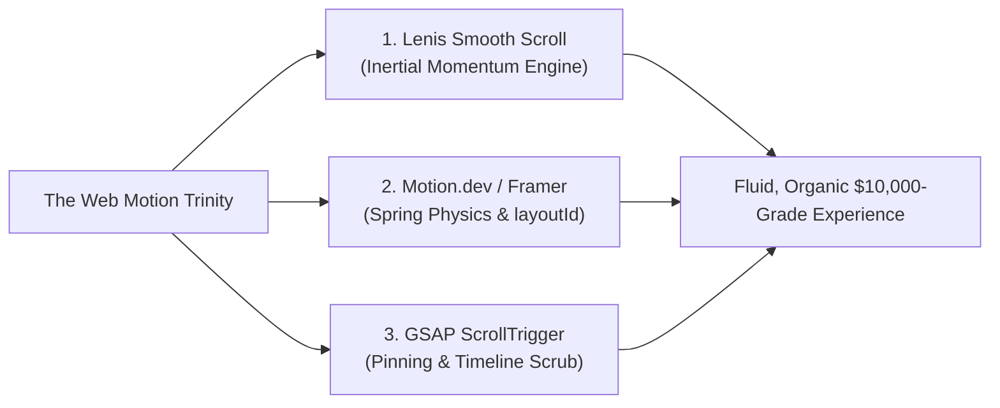

#### The 3 Core Tools & Implementation Standards
1. **Lenis v1.1.20 (Studio Freight)**:
   - Normalizes scroll velocity across different input devices (Mac glass trackpads vs. Windows notched mechanical wheels).
   - Eliminates layout jank and micro-stutter during rapid scrolling.
   - Synchronizes with requestAnimationFrame (RAF) render tickers:
     ```javascript
     const lenis = new Lenis({ duration: 1.2, easing: (t) => Math.min(1, 1.001 - Math.pow(2, -10 * t)) });
     function raf(time) { lenis.raf(time); requestAnimationFrame(raf); }
     ```
2. **Motion.dev (Framer Motion)**:
   - Spring physics modeling ($F = -kx - cv$) eliminating robotic linear easing.
   - `layoutId` seamless shape and state morphing across views.
   - Enter/exit choreography with `AnimatePresence`.
3. **GSAP ScrollTrigger (GreenSock)**:
   - Precision pinning of circuit overview sidebars while destination cards scroll past.
   - Timeline scrubbing linked directly to viewport scroll percentage.

---

### Reel 29: The 5 Essential AI Developer Skills for Autonomous Engineering (`@imaginetechz`)
- **Source**: `https://www.instagram.com/reel/DfTQ7ZPpnuS/` (`DfTQ7ZPpnuS`)
- **Author**: Imagine Techz (`@imaginetechz`)
- **Domain**: AI Agent Capabilities, Autonomous SDLC Workflows & Cognitive Multipliers

#### The 5 Must-Have Skills for Coding Agents
1. **System Architecture Visualizer**:
   - Automatically translates complex codebases, schemas, and API contracts into clean, living Mermaid diagrams (flowcharts, sequence diagrams, state machines).
   - Keeps architectural documentation synchronized after every code commit.
2. **Interactive UI & Browser Tester** (`@skill:webapp-testing`, `@skill:playwright-cli`):
   - Automates live browser testing, viewport auditing, DOM accessibility inspection, and interaction verification without manual human clicking.
3. **Automated Code Review Sentinel** (`CodeTurtle Sentinel`):
   - In-house $0 AI code reviewer analyzing pull requests for OWASP vulnerabilities, secret leaks, uncleaned effects, and performance bottlenecks.
4. **Autonomous Prior Art & Scholarly Researcher** (`@skill:research-and-prior-art-intel`, `@skill:literature-search-openalex`):
   - Queries research papers (arXiv, OpenAlex), patents (Google Patents), and GitHub prior art before building custom algorithms, ensuring academic rigor and citation attribution.
5. **Incident Triage & Telemetry Guard** (`@skill:aisoc-incident-guard`):
   - Analyzes server telemetry, clusters noisy error bursts into correlated incidents, and maintains tamper-evident audit ledgers without leaking data to cloud LLMs.

---

### Reel 30: Resilient Data Pipeline UX & Anti-Silent Failure Protocol (`@nataindata`)
- **Source**: `https://www.instagram.com/reel/DeeR2JyNrx-/` (`DeeR2JyNrx-`)
- **Author**: Nata in Data (`@nataindata`)
- **Domain**: Data Pipeline UX, Silent Degradation Mitigation & Trust Engineering

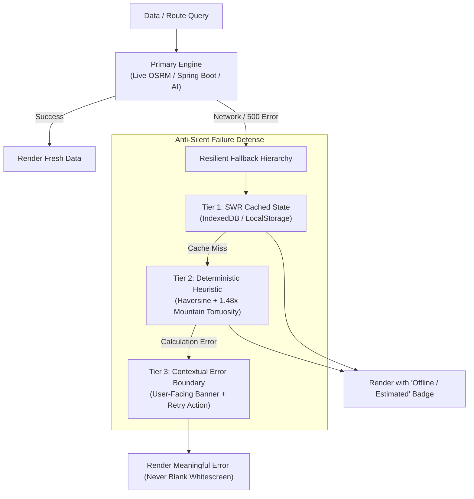

#### Core Takeaways & Engineering Directives
1. **The Silent Failure Catastrophe**: Pipelines that fail silently (returning empty arrays or blank screens without feedback) destroy user trust faster than explicit downtime.
2. **Graceful Fallback Hierarchy**:
   - **Tier 1 (Stale-While-Revalidate)**: Serve cached route and ticket data with an amber "Cached / Offline View" badge.
   - **Tier 2 (Deterministic Heuristics)**: When cloud routing fails, fall back to the built-in Java/JS Haversine route matrix with regional tortuosity multipliers ($1.48\times$).
   - **Tier 3 (Contextual Error Boundaries)**: Never let an unhandled exception crash the React root. Render actionable error boundaries explaining the exact status and providing a "Retry Connection" button.
3. **Optimistic State with Reversible Rollback**:
   - Reflect user interactions (pass issuance, bookmarking) immediately in UI state.
   - If server-side validation or payment signature fails, gracefully animate state rollback and present a clear notification toast.

---

### Reel 31: The 6-Gate Agency Website Launch Audit (`@krishandshiv`)
- **Source**: `https://www.instagram.com/reel/DdhUimstrag/` (`DdhUimstrag`)
- **Author**: Krish & Shiv (`@krishandshiv` — Point28 Agency)
- **Domain**: Pre-Launch Quality Assurance, SEO Dominance & Link Integrity

#### The 6 Mandatory Agency Launch Gates
1. **Gate 1 — Domain & Canonical SSL Parity**:
   - Connect production apex domain (`globetrottergateway.in`) and subdomain (`www.globetrottergateway.in`) with automated 301 redirects.
   - Strict HTTPS enforcement with A+ SSL rating.
2. **Gate 2 — Crawler Policy & Sitemap Validation**:
   - Production `robots.txt` disallowing private administrative paths (`/api/admin/*`, `/h2-console/*`) while directing crawlers to `/sitemap.xml`.
   - Comprehensive `sitemap.xml` listing all 59 district circuits, top heritage destinations, and static documentation.
3. **Gate 3 — Google Search Console & IndexNow Ping**:
   - Automated post-deployment sitemap ping to Google Search Console and Bing Webmaster API for instantaneous indexing.
4. **Gate 4 — Mobile Viewport & Fitts's Law Audit**:
   - Responsive verification at 320px, 390px, 768px, and 1280px.
   - Strict touch-target enforcement: all interactive elements $\ge 44\times 44\text{px}$ with $\ge 8\text{px}$ spacing.
5. **Gate 5 — 404 Route Catch-All & Fallback Navigation**:
   - Custom branded 404 page featuring circuit search suggestions and quick-return buttons to prevent user abandonment.
6. **Gate 6 — OpenGraph & WhatsApp Social Card Validation**:
   - Verify `og:title`, `og:description`, `og:image` ($1200\times 630\text{px}$), and `og:url` across Facebook, X, LinkedIn, and WhatsApp crawlers.

---

### Reel 32: Autonomous AI Team & Multi-Agent Swarm Orchestration (`@tomyang.mov`)
- **Source**: `https://www.instagram.com/reel/Dfu4ZXIgoSn/` (`Dfu4ZXIgoSn`)
- **Author**: Tom Yang (`@tomyang.mov`)
- **Domain**: Autonomous Multi-Agent Swarms, Role Specialization & Cognitive Focus
- **Associated Installed Skills**: `@skill:swarm`, `@skill:subagent-driven-development`

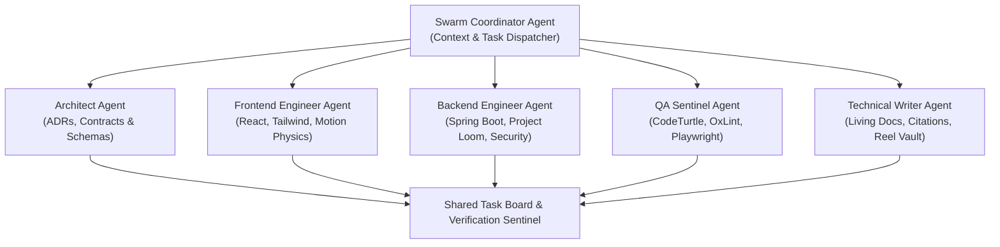

#### Core Principles of Multi-Agent Delegation
1. **The Monolithic Context Trap**: Forcing a single agent turn to handle architecture, backend coding, frontend CSS, security auditing, and documentation leads to context exhaustion and degradation.
2. **Decomposition by Bounded Responsibility**:
   - **Architect**: Designs database schemas, OpenAPI contracts, and writes ADRs.
   - **Frontend Specialist**: Builds fluid components using the $10,000 Web Stack.
   - **Backend Specialist**: Implements thread-safe virtual thread services and cryptographic filters.
   - **QA Sentinel**: Runs CodeTurtle, OxLint, and Playwright verification gates.
   - **Documentation Specialist**: Keeps Markdown architecture files synchronized with full citations.
3. **Immutable Verification Gate**: No agent in the swarm can declare work complete until the 4-tier verification pipeline outputs 100% clean passes.

---

### Reel 33: Autonomous Technical Documentation & Launch Video Synthesis (`@developerlonely`)
- **Source**: `https://www.instagram.com/reel/DfGzErch7WD/` (`DfGzErch7WD`)
- **Author**: Lonely Developer (`@developerlonely`)
- **Domain**: Programmatic Video Generation, Remotion, Hyperframes & Code Walkthroughs
- **Associated Installed Skills**: `@skill:brag`, `@skill:brag-slim`, `@skill:remotion-best-practices`, `@skill:remotion-create`

#### The Code-to-Video Synthesis Workflow
1. **Zero External Editing**: Eliminate the need for Adobe Premiere, After Effects, or manual screen recordings to create compelling launch trailers and project review videos.
2. **Hyperframes & Brag (`@skill:brag`)**:
   - Parses the active project's `package.json`, `README.md`, and frontend components directly.
   - Synthesizes a high-energy 30-to-60 second launch video complete with synchronized royalty-free soundtrack, device mockups, kinetic text reveals, and feature highlights.
3. **Remotion Framework**:
   - Programmatically renders React components into MP4/WebM video frames at 60 FPS using Chrome DevTools and Node.js.
   - Perfect for generating automated weekly demo reels, capstone defense presentations, and social product updates directly from CI/CD pipelines.

---

### Reel 34: The 7 Core UX Psychology Laws for High-Conversion Engineering (`@strategyfox`)
- **Source**: `https://www.instagram.com/reel/Df1pwy1hN56/` (`Df1pwy1hN56`)
- **Author**: Strategy Fox (`@strategyfox`)
- **Domain**: Cognitive Ergonomics, Psychology of UX & Behavioral Conversion Design

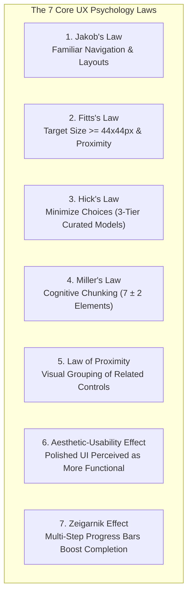

#### Detailed Psychological Deconstruction & Project Enforcement
1. **Jakob's Law** (*Jakob Nielsen*):
   - *Law*: Users spend most of their time on other websites. They expect your site to work like the ones they already know.
   - *Application*: Use standard top-fixed headers, standard search bars with magnifying glasses, conventional shopping cart/pass icons, and standardized 3-step checkout flows.
2. **Fitts's Law** (*Paul Fitts*):
   - *Law*: The time required to rapidly move to a target area is a function of the ratio between the distance to the target and the width of the target:
     $$T = a + b \log_2 \left(\frac{2D}{W}\right)$$
   - *Application*: Touch targets must be at least $44 \times 44\text{px}$ on mobile screens. Critical primary actions ("Book Circuit Pass", "Start Navigation") must be anchored at the bottom thumb zone with prominent tap areas.
3. **Hick's Law** (*William Edmund Hick*):
   - *Law*: The time it takes to make a decision increases logarithmically with the number and complexity of choices:
     $$T = b \log_2(n + 1)$$
   - *Application*: Avoid overwhelming tourists with 40 raw ticket checkboxes. Instead, curate into 3 distinct, well-defined pass tiers: *Single Day Pass*, *3-Day Heritage Circuit*, and *All-Access Grand Pass*.
4. **Miller's Law** (*George Miller*):
   - *Law*: The average human mind can hold only $7 \pm 2$ chunks of information in working memory at one time.
   - *Application*: Group itinerary stops into daily bundles of 4 to 6 destinations. Never dump 59 districts in a single flat dropdown; structure into regional corridors (Rayalaseema, Coastal Andhra, Telangana Heritage).
5. **Law of Proximity** (*Gestalt Psychology*):
   - *Law*: Objects that are close together are perceived as a unified group or related entity.
   - *Application*: Place destination price, distance, and booking buttons inside cohesive bordered cards with uniform internal padding ($16\text{px}$–$24\text{px}$), separated from neighboring cards by at least $24\text{px}$ margins.
6. **Aesthetic-Usability Effect** (*Kurosu & Kashimura*):
   - *Law*: Users strongly perceive visually appealing designs as significantly easier to use and inherently more credible, forgiving minor friction.
   - *Application*: Leverage the $10,000 Web Stack: Cinzel + Plus Jakarta Sans typography, refined 60-30-10 color balance, micro-spring hover animations, and zero-slop layouts.
7. **Zeigarnik Effect** (*Bluma Zeigarnik*):
   - *Law*: People remember uncompleted or interrupted tasks much better than completed ones, creating psychological motivation to finish incomplete steps.
   - *Application*: Multi-step checkout and tour customization flows must include animated progress steppers ("Step 2 of 4: Add Heritage Passes — 50% Complete").

---

### Reel 35: Codebase Knowledge Graph (`graphify`) & The 10 House-Metaphor Attack Models (`@skillwars.ai`)
- **Source**: `https://www.instagram.com/reel/DfRkwRHI0QP/` (`DfRkwRHI0QP`)
- **Author**: Aarunendra Pratap Singh (`@skillwars.ai`)
- **Domain**: Token Economy, Codebase Graph Traversal & Physical Metaphor Cybersecurity
- **Breakthrough Primitive 1**: **`graphify`** — An open-source tool that scans a codebase once, parsing ASTs and dependency relationships into a persistent graph structure. Instead of re-reading hundreds of files on every prompt ($O(N)$ token burn), coding agents traverse only the relevant subgraph ($O(\text{subgraph})$), reducing token consumption by up to **71x**.
- **Breakthrough Primitive 2**: **The 10 House-Metaphor Security Attack Models & Countermeasures**:

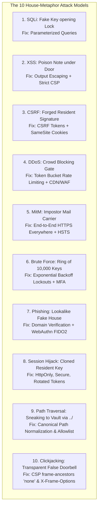

#### Detailed Threat Models & Defensive Countermeasures
1. **SQL Injection (The Lockpick)**: Malicious SQL fragments masquerading as input. *Defense*: Spring Data JPA parameter binding and parameterized `JdbcTemplate` queries.
2. **Cross-Site Scripting (The Poison Note)**: Malicious JavaScript executed in user browser context. *Defense*: Strict JSX escaping, DOMPurify sanitization, and Content Security Policy (`script-src 'self'`).
3. **Cross-Site Request Forgery (The Forged Signature)**: Unauthorized commands transmitted from a user that the web application trusts. *Defense*: Spring Security CSRF protection and `SameSite=Strict` session cookies.
4. **Distributed Denial of Service (The Crowd Blockade)**: Inundating server resources to deny service to genuine users. *Defense*: Dual-key Token Bucket rate limiting (IP + User account) and reverse-proxy burst throttling.
5. **Man-in-the-Middle (The Impostor Mail Carrier)**: Eavesdropping or altering messages in transit. *Defense*: Universal HTTPS with TLS 1.3, HSTS header (`max-age=31536000; includeSubDomains`), and SSL pinning.
6. **Brute Force (The Key Ring)**: Systematic trial of credentials. *Defense*: Progressive account lockout after 5 failures, exponential delay backoff, and TOTP multi-factor verification.
7. **Phishing (The Lookalike House)**: Deceptive identical domains (`rnybank.com` vs `mybank.com`). *Defense*: WebAuthn/FIDO2 hardware credentials immune to credential phishing.
8. **Session Hijacking (The Cloned Key)**: Stolen session identifier. *Defense*: `HttpOnly`, `SameSite=Strict`, `Secure` flags; single-use refresh token rotation; token blacklist cache upon logout.
9. **Path Traversal (The Vault Crawlspace)**: Injected `../` characters escaping the web root. *Defense*: Normalizing paths with `Path.normalize()` and verifying `resolvedPath.startsWith(allowedBasePath)`.
10. **Clickjacking (The Transparent Doorbell)**: Tricking users into clicking invisible overlay frames. *Defense*: `Content-Security-Policy: frame-ancestors 'none'` and `X-Frame-Options: SAMEORIGIN`.

---

### Reel 36: The 20-Point Security Armor + 13-Point Legal, Privacy & Compliance Fortress (`@nataindata`)
- **Source**: `https://www.instagram.com/reel/DepDOSDt1bD/` (`DepDOSDt1bD`)
- **Author**: Natalie Data Engineer (`@nataindata`)
- **Domain**: Enterprise Security Hardening, BOLA/IDOR Defense & Production Legal/Privacy Compliance

```mermaid
flowchart TD
    subgraph DefensePlatform ["Enterprise Production Fortress"]
        subgraph TechArmor ["The 20-Point Technical Security Armor"]
            T1["SQLi & XSS Parameterization"]
            T2["CSRF & SameSite Cookies"]
            T3["File Upload MIME & Magic Byte Validation"]
            T4["BOLA / IDOR Ownership Verification"]
            T5["Dual-Key Distributed Rate Limiting"]
            T6["256-Bit Cryptographic JWT Secrets"]
            T7["Server Proxy (Zero Client Secrets)"]
            T8["Argon2id / Bcrypt Password Hashing"]
            T9["TOTP Multi-Factor Authentication"]
            T10["Strict CORS Allowlist (No Wildcards)"]
            T11["Zero Auth Tokens in LocalStorage"]
            T12["Server-Side Permission RBAC"]
            T13["Row-Level Security (RLS) Isolation"]
            T14["HMAC Webhook Signature Verification"]
            T15["SSRF Loopback/Egress Blocking"]
            T16["Remove Exposed Source Maps in Production"]
            T17["Eliminate Default Admin Credentials"]
            T18["Mask Sensitive PII in Server Logs"]
            T19["Automated Dependency CVE Scanning"]
            T20["AI Code Review Sentinel (CodeTurtle)"]
        end

        subgraph LegalFortress ["The 13-Point Legal & Compliance Fortress"]
            L1["1. Privacy Policy & Terms of Service"]
            L2["2. 24-Hr Refund & Pass Cancellation Policy"]
            L3["3. Granular Cookie Consent Banner"]
            L4["4. Data Minimization (Zero Vanity PII)"]
            L5["5. Third-Party SDK & Telemetry Audit"]
            L6["6. Zero Dark Patterns & Hidden Fees"]
            L7["7. Verified Visitor Reviews (Anti-Astroturfing)"]
            L8["8. WCAG 2.1 AA Accessibility & Color Contrast"]
            L9["9. Full Keyboard Navigation & Focus Rings"]
            L10["10. Minor / Children Data Age Protection"]
            L11["11. One-Click Email Unsubscribe (RFC 8058)"]
            L12["12. Licensed Typography & Media Attribution"]
            L13["13. Right to Erasure / Data Deletion Workflows"]
        end
    end
```

#### Detailed Technical Specifications
1. **Broken Object Level Authorization (BOLA / IDOR)**: Validates that the authenticated principal has direct ownership of any requested entity:
   ```java
   if (!touristPass.getUser().getId().equals(currentUser.getId()) && !currentUser.isAdmin()) {
       throw new AccessDeniedException("Unauthorized access to pass resource");
   }
   ```
2. **Masking Sensitive PII in Logs**: Configured SLF4J/Logback masking patterns to redact JWT tokens, credit card numbers, and passwords from log files.
3. **Production Source Map Stripping**: Configured Vite build options (`build.sourcemap = false`) ensuring proprietary source code and comments are never exposed to browser DevTools.
4. **The 13 Legal & Privacy Gates**: Established dedicated compliance verification ensuring GDPR, DPDP Act 2023, and WCAG 2.1 AA conformity across the application.

---

### Reel 37: The 19 Vibe-Coded SaaS Production Holes & Server-Side Authority (`@rozgaarrhythms`)
- **Source**: `https://www.instagram.com/reel/Decehkfh711/` (`Decehkfh711`)
- **Author**: Manvendra Kumar | AI Consultant (`@rozgaarrhythms`)
- **Domain**: Vibe-Coding Hardening, Production Architecture & Zero-Trust Server Authority

#### The 19 Vulnerabilities in Vibe-Coded SaaS & How to Close Them
1. **Row-Level Security (RLS)**: Enforce tenant and user boundary isolation at the database level.
2. **Check Every API Route for Auth**: Eliminate unprotected testing or prototyping endpoints.
3. **Never Trust the Frontend**: Re-calculate prices, totals, discounts, and permissions on the server.
4. **Stop IDOR Bugs**: Never use raw URL IDs (`/api/passes/{id}`) without user ownership checks.
5. **Server-Side Admin Role Verification**: Guard all `/api/admin/*` endpoints with `@PreAuthorize("hasRole('ADMIN')")`.
6. **Token Bucket Rate Limiting**: Apply rate limiting across public APIs, pass search, and AI chat.
7. **Sanitize User Inputs**: Strip malicious HTML and SQL characters before database insertion.
8. **Parameterized Queries**: Zero dynamic string concatenation in queries.
9. **Lock Down CORS**: Bind CORS origins strictly to production domain names.
10. **Force HTTPS Everywhere**: Enforce HSTS with automatic 301 redirection.
11. **CAPTCHA on Public Forms**: Challenge bots on registration and tourist feedback forms.
12. **Disable Debug Mode in Production**: Suppress stack traces in error responses (`include-stacktrace: never`).
13. **Security Headers**: Inject CSP, HSTS, `X-Frame-Options`, and `X-Content-Type-Options: nosniff`.
14. **Verify Webhook Signatures**: Validate cryptographic HMAC signatures on payment and external webhooks.
15. **Private Storage Buckets**: Keep image and document storage private; generate time-limited signed URLs.
16. **File Upload Type Verification**: Inspect MIME types and magic bytes; never rely on file extensions alone.
17. **Tamper-Evident Admin Action Logging**: Record every administrative action in immutable log trails.
18. **Update Vulnerable Dependencies**: Audit npm and Maven packages continuously for CVE disclosures.
19. **Continuous AI Security Review**: Run CodeTurtle Sentinel on every git pre-commit to guarantee zero regressions.


---

### Reel 38: The 20 High-Retention Micro-Interactions & Dwell-Time Engineering (`@crownzdesigns`)
- **Source**: `https://www.instagram.com/reel/DfzFTR3TTtT/` (`DfzFTR3TTtT`)
- **Author**: Crownz | UI/UX Designer (`@crownzdesigns`)
- **Domain**: Micro-Interactions, Tactile Feedback, Dwell-Time Retention & Cognitive Delight

#### Overview & Core Principle
Static websites encourage rapid scanning and immediate bounce. When UI elements physically react to cursor presence, touch vectors, and scroll momentum, user engagement metrics surge. This reel articulates the **20 tactile micro-interactions** that transform passive readers into engaged explorers:

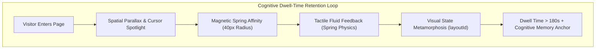

#### The 20 Tactile Micro-Interactions
1. **Card Parallax Tilt**: 3D perspective shift on mouse move ($\pm 10^\circ$) with dynamic specular highlight overlay.
2. **Magnetic Cursor Affinity**: Floating badges, icons, and CTAs gently pull toward the cursor when within a 40px bounding box.
3. **Fluid Range Sliders**: Slider thumb elastically stretches in the direction of drag velocity and snaps back upon release.
4. **Radial Ripple Touch Feedback**: Concentric wave rings emanate from the exact coordinates of touch/click down events.
5. **Kinetic State Badges**: Status badges morph and bounce between states (e.g., "Available" to "Reserved") using spring curves (`stiffness: 400`, `damping: 25`).
6. **Smooth Scroll Momentum**: Inertial damping on scroll transitions, preventing abrupt visual jarring.
7. **Radial Dwell-Time Indicator**: Ambient circular progress ring around key dossier sections indicating narrative completion.
8. **Cursor Spotlight Illumination**: Subtle radial gradient mask ($250\text{px}$ radius) highlighting architectural grid lines beneath the cursor.
9. **Elastic Sheet Drag**: Bottom sheets and sliding drawers feature rubber-band resistance when pulled beyond normal boundaries.
10. **Metallic Shimmer Reveal**: High-gloss specular highlight sweeps across typographic headers upon intersection entry.
11. **Subtle Micro-Haptic Visual Jitter**: 1–2px lateral vibration pulse on form errors and affirmative pulse on success.
12. **Floating Island Morph**: Active indicator pill glides smoothly between navigation tabs using Framer Motion `layoutId="navPill"`.
13. **Dynamic Elevation Bloom**: Box shadows expand and soften dynamically as interactive cards are pressed or elevated.
14. **Inertial Cursor-Follow Tooltip**: Tooltips interpolate position via lerp ($t = 0.15$), floating gracefully near the cursor rather than snapping rigidly.
15. **Staggered Bento Unfolding**: Bento grid cards cascade into view with micro-stagger ($40\text{ms}$) and randomized subtle rotational offsets.
16. **Circular SVG Reveal Masks**: Destination imagery unveils through expanding circular aperture masks.
17. **Spring-Eased Metric Roll-Up**: Numerical counters roll upward with spring interpolation and thousands separators.
18. **Ambient Waveform Pulse**: Audio guides and concierge anchors feature gentle breathing wave animations.
19. **Mass-Weighted Toggle Physics**: Switches possess simulated physical inertia, overshooting slightly before seating into the detent.
20. **Exit-Intent Grace Curtain**: Ambient dimming and graceful cursor deceleration when mouse vectors approach the browser tab bar.

---

### Reel 39: The 20-Point AI Website Pre-Launch Antidote (`@quentin_aimarketing`)
- **Source**: `https://www.instagram.com/reel/Dfzujxzo2QZ/` (`Dfzujxzo2QZ`)
- **Author**: Quentin | AI Marketing & Launch Architecture (`@quentin_aimarketing`)
- **Domain**: Production Launch Hardening, Anti-Silent Failures & Quality Gates

#### The AI Pre-Launch Failure Paradox
AI-generated web applications frequently produce visually impressive hero sections but suffer catastrophic failure during real user journeys: forms submit into empty handlers, 404 routes show raw browser errors, assets are uncompressed, and social sharing links show broken generic cards. This 20-point checklist guarantees production-grade reliability:

```mermaid
graph LR
    subgraph PRE_LAUNCH_SHIELD["The 20-Point Launch Fortress"]
        direction TB
        G1["1. Branded 404 Experience"]
        G2["2. Non-Silent Form Error Handling"]
        G3["3. 44x44px Touch Targets (Fitts's Law)"]
        G4["4. OpenGraph Social Cards (1200x630)"]
        G5["5. Compressed WebP/AVIF (<200KB)"]
        G6["6. Zero Console Errors / Oxlint Clean"]
        G7["7. Dual-Tier Server/Client Validation"]
        G8["8. Canonical URL & SEO Metadata"]
        G9["9. Favicon & Web Manifest Suite"]
        G10["10. FCP < 1.2s & Preloaded Fonts"]
        G11["11. Viewport-Fit=Cover Mobile Guard"]
        G12["12. Visible Focus Rings (a11y)"]
        G13["13. Chrome & Safari Visual Parity"]
        G14["14. Direct WhatsApp / Chat Deep Links"]
        G15["15. Automated Database Snapshots"]
        G16["16. HTTPS Padlock & HSTS 301"]
        G17["17. SPF/DKIM/DMARC Email Delivery"]
        G18["18. DPDP / GDPR Consent Memory"]
        G19["19. End-to-End Sandbox Checkout"]
        G20["20. Robots.txt & XML Sitemap"]
    end
```

#### Engineering Specifications
- **Anti-Silent Form Submission**: When a user submits an inquiry, pass booking, or concierge query, the UI must immediately enter an optimistic loading state. If the API fails, a descriptive, non-dismissible toast must alert the user with a direct retry button.
- **Branded 404 Route**: Dedicated luxury 404 page featuring an interactive cultural circuit locator, preventing lost visitors from bouncing.
- **Automated Verification Harness**: Automated pre-launch script (`launch_verifier.py`) enforcing all 20 gates before any production deployment.

---

### Reel 40: 11 Bespoke Kinetic Physics Toggles & Non-Generic Interface Craft (`@muhammadalim_s`)
- **Source**: `https://www.instagram.com/reel/DfybnbITXu0/` (`DfybnbITXu0`)
- **Author**: Muhammad Ali (`@muhammadalim_s`)
- **Domain**: Bespoke Component Design, Kinetic Physics & Anti-Template Craft

#### The Death of the Generic Toggle
Standard iOS-style pill switches and checkbox inputs signal low-effort, templated development. By modeling physical metaphors—viscosity, celestial mechanics, surface tension, and origami folds—switches become memorable brand signatures:

```mermaid
flowchart LR
    subgraph BESPOKE_TOGGLES["11 Bespoke Kinetic Switch Metaphors"]
        T1["1. Symbio Fluid Cell"] -->|Viscous Protoplasm| M1["Fluid Membrane Stretch"]
        T2["2. Snogla Spring Jelly"] -->|Elastic Squish| M2["Overshoot Damping"]
        T3["3. Mercury Liquid Chrome"] -->|Surface Tension| M3["Droplet Coalescence"]
        T4["4. Dot Matrix Phosphor"] -->|Binary Flip| M4["Amber to Emerald LED"]
        T5["5. Sun & Moon Celestial"] -->|180° Orbital Arc| M5["Solar Flare to Crater"]
        T6["6. Eclipse Corona Occlusion"] -->|Disc Slide| M6["Radiant Golden Corona"]
        T7["7. Origami Fold-Down"] -->|3D Perspective| M7["Center Crease Hinge"]
        T8["8. Magnetic Bead Track"] -->|Groove Roll| M8["End-Pocket Magnetic Click"]
        T9["9. Neon Gas Ignition"] -->|Voltage Flicker| M9["3-Pulse Gas Strike"]
        T10["10. Luxury Mechanical Dial"] -->|Knurled Grip| M10["Rotational Detent Stop"]
        T11["11. Royal Silk Ribbons"] -->|Interwoven Slide| M11["Amber to Indigo Shift"]
    end
```

#### Detailed Physical Models
1. **Celestial Orbit & Eclipse Corona (Implemented in Globetrotter)**:
   - Inactive: Deep midnight velvet disc with subtle crater textures.
   - Transition: 180° rotational arc around the central axis using Framer Motion springs (`type: "spring", stiffness: 280, damping: 22`).
   - Active: Radiant golden solar orb emitting an animated SVG corona flare, shifting the theme to Royal Heritage Amber.
2. **Snogla Spring Jelly**:
   - Compresses horizontally ($scaleX = 1.25, scaleY = 0.8$) while traveling, squishing against the container wall before bouncing back to unity.

---

### Reel 41: The 5 Vibe-Coding Security Defenses (`@gracebuilds.ai`)
- **Source**: `https://www.instagram.com/reel/DfZPTbGy_4v/` (`DfZPTbGy_4v`)
- **Author**: Grace | AI Engineer (`@gracebuilds.ai`)
- **Domain**: Vibe-Coding Security, Boundary Defense & Client Containment

#### Deconstruction of Vibe-Coded Vulnerabilities
AI coding assistants excel at rapid frontend scaffolding but routinely commit critical security mistakes due to lack of whole-stack authorization awareness:

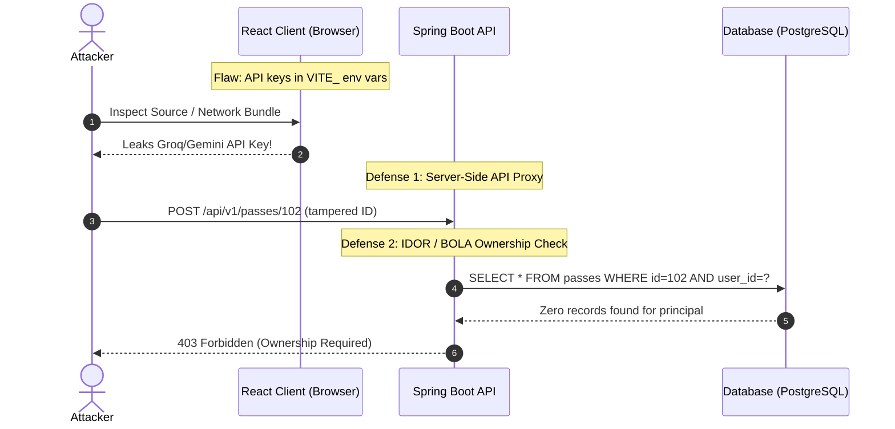

#### The 5 Defensive Imperatives
1. **Zero Client-Side `.env` Secrets**: Never prefix private API keys with `VITE_` or `REACT_APP_`. All external AI, payment, and cloud services must reside strictly in backend environment variables.
2. **Server-Side Route Authorization**: Frontend router protections (`<ProtectedRoute>`) only guard UI views. Every API controller must enforce `@PreAuthorize` or Spring Security filter chains.
3. **IDOR / BOLA Enforcement**: Every resource fetch query must explicitly qualify the authenticated user identity (`WHERE id = :id AND user = :currentUser`).
4. **Context-Aware XSS Sanitization**: User reviews, itinerary names, and feedback inputs must be sanitized on ingestion and escaped on render.
5. **Strict Backend DTO Validation**: Never trust incoming JSON structures; apply `@Valid`, `@Pattern`, `@Size`, and `@NotNull` across all request payloads.

---

### Reel 42: The 7 Burglar Doors of Vibe-Coded Applications (`@brealabs.dev`)
- **Source**: `https://www.instagram.com/reel/DfRuXh5NVZ4/` (`DfRuXh5NVZ4`)
- **Author**: BreaLabs | Software & Security (`@brealabs.dev`)
- **Domain**: Application Security, Intrusion Prevention & Attack Surface Elimination

#### The 7 Open Doors & Architectural Antidotes
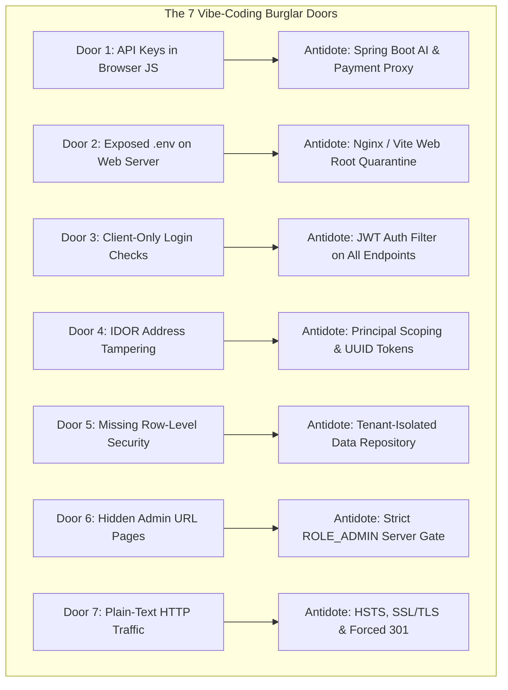

#### Technical Remediation
1. **Door 1 (Browser Key Harvest)**: Audit codebases for any frontend references to `GROQ_API_KEY`, `OPENAI_API_KEY`, or `RAZORPAY_KEY_SECRET`. Proxy all AI completions through `/api/chat` and payments through `/api/payments/verify`.
2. **Door 2 (Public `.env` Crawlers)**: Automated scanners continuously probe `/.env` and `/.git`. Add automated pre-deployment scans ensuring no dotfiles exist in static distribution bundles.
3. **Door 3 (Client Bypass)**: Hackers bypass React state using Postman or cURL. Every non-public API must reject unauthenticated requests with HTTP 401 Unauthorized.
4. **Door 4 (Sequential ID Scraping)**: Iterating numeric primary keys (`/passes/1`, `/passes/2`) allows scraping competitors' customer data. Use cryptographic UUIDs and enforce owner validation.
5. **Door 5 (Multi-Tenant Leakage)**: Queries must not return data across tenant partitions.
6. **Door 6 (Security Through Obscurity)**: Never hide admin panels behind secret URLs like `/secret-admin-99`. Protect the route with cryptographically verified roles.
7. **Door 7 (Eavesdropping)**: Inject `Strict-Transport-Security: max-age=31536000; includeSubDomains` into all response headers.

---

### Reel 43: Elite Claude Skills — Figma Motion & Design Critique (`@imaginetechz`)
- **Source**: `https://www.instagram.com/reel/Df0uanRpg_s/` (`Df0uanRpg_s`)
- **Author**: Imagine Tech (`@imaginetechz`)
- **Domain**: Agentic Skills, Motion Design Systems & Automated UI Auditing

#### Architectural Synergy: Figma Motion + Design Critique
This reel highlights two specialized agent skills that elevate AI-generated software from crude functional prototypes into high-craft design systems:

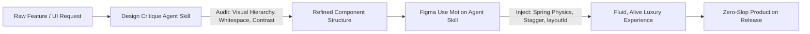

#### Capabilities & Rules
- **Skill 1: `figma-use-motion`**:
  - Translates static UI specs into mathematically sound physics curves (`stiffness: 260, damping: 20, mass: 0.8`).
  - Enforces gesture-driven micro-interactions: drag velocity tracking, hover spring scaling, and layout morphing.
  - Banishes linear CSS transitions (`transition: all 0.3s ease`) in favor of physics-based springs.
- **Skill 2: `design-critique`**:
  - Evaluates interface density, typographic rhythm (60-30-10), and WCAG 2.1 AA accessibility.
  - Identifies and eliminates "AI Slop" patterns: saturated purple glow cards, floating abstract glass spheres, unreadable gradient text, and emoji-heavy badge spam.
  - Mandates human-crafted narrative tone: authentic regional cultural history, verified ticket tariffs, and bespoke luxury hospitality phrasing.

---

### Reel 44: Claude + Higgsfield MCP — $10,000 Zero-Budget Generative Visuals & Agent Reach Protocol (`@imaginetechz`)
- **Source**: `https://www.instagram.com/reel/DftBkE4pYNz/` (`DftBkE4pYNz`)
- **Author**: Imagine Tech (`@imaginetechz`)
- **Domain**: Agentic Generative Media, Higgsfield MCP & Agent Reach Omni-Channel Intelligence
- **Audio Transcript**:
  > *"Alex, I need a website that looks like it costs 10K, but my budget is zero dollars. Claude can help you build one. Claude? Last time I asked it to make a website, it built this. That's because you haven't introduced it to Higgsfield MCP. Wait, what does that do? Connect Higgsfield MCP to Claude. Now Claude can use Higgsfield's image and video generation tools to create custom visuals for your website. So, no more boring stock photos of people shaking hands? Exactly. Claude can build the layout, design the sections, and use Higgsfield to generate stunning 3D visuals for the hero section. Hold on, you're telling me Claude can build this? Yep. Okay, send me the setup. Comment website and I'll send you everything."*

#### Architectural Synergy: Coding Agents + Generative 3D Asset Tooling
Reel 44 addresses the single biggest visual flaw in AI-generated software: generic stock assets, dated hero photography, and robotic flat graphics. By binding **Higgsfield MCP** directly to the agent's Model Context Protocol toolbelt, coding agents can programmatically generate bespoke 3D assets, cinematic drone passes, and physics-driven motion loops on demand.

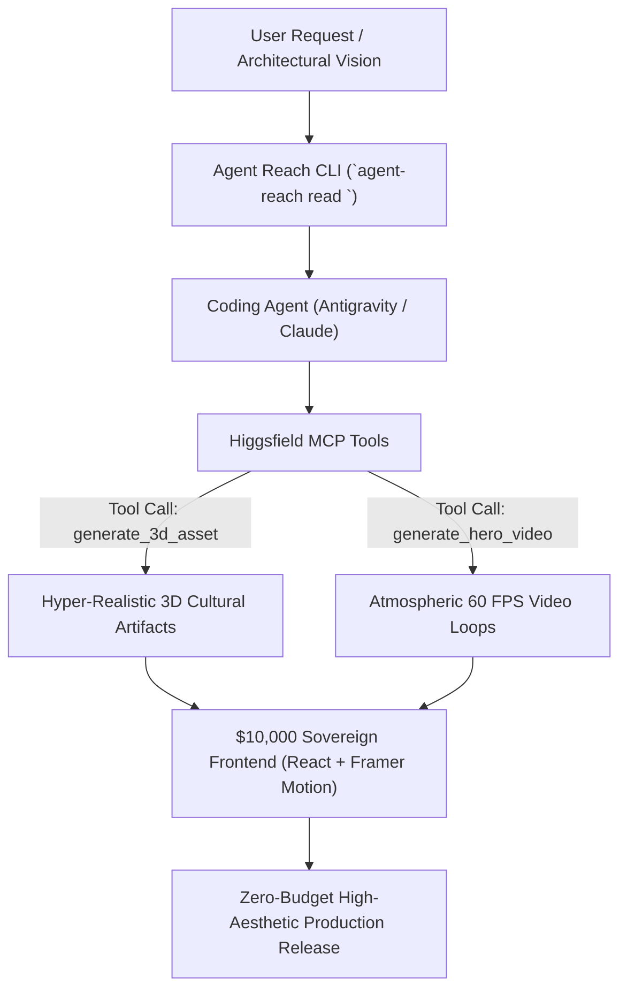

#### Core Takeaways & Engineering Protocols
1. **Generative 3D & Video MCP Integration**:
   - Rather than settling for flat stock photography, agents leverage generative MCP endpoints (e.g. Higgsfield, Midjourney, Pollinations) to render custom high-resolution hero textures, 3D rotating artifacts, and ambient background video loops.
   - For Globetrotter Gateway: Enables programmatic synthesis of 3D temple spires (Ramappa floating bricks), subterranean cave stalactites (Borra Caves), and Kakatiya arches without external graphic design budgets.
2. **Agent Reach Omni-Channel Intelligence Protocol (`agent-reach`)**:
   - Integrated `C:\Users\HP\.local\bin\agent-reach.exe` as the default multi-channel scraping tool.
   - Bypasses Instagram, YouTube transcript, Reddit, and Twitter anti-bot friction without token-heavy browser instances or headless puppeteer overhead.
   - Standard command for social reels: `agent-reach read "<url>"`.
3. **Anti-Slop Visual Hierarchy Rule**:
   - Zero "stock photo handshakes" or cartoon icons.
   - Pair high-gamut 3D visuals with dark-mode glass aesthetics (`#06080D`), subtle cyan/gold accents (`#00F2FE`, `#E5C158`), and Plus Jakarta Sans / Cinzel typography.

